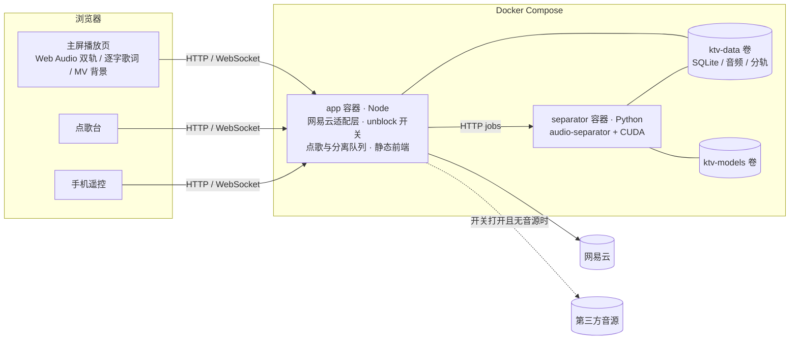

# Netease-KTV 技术可行性调研

> 调研日期：2026-10-22（同日修订：增加 unblock 开关、Docker 部署、前端设计）
> 目标：基于网易云音乐获取歌曲、MV 和歌词，用 AI 去人声生成伴奏，做成一个本地 KTV。默认只使用登录账号有权播放的内容。
> 参考项目：[nooblong/NeteaseCloudMusicApiBackup](https://github.com/nooblong/NeteaseCloudMusicApiBackup)、[ddmmbb-2/OpenKTV-AI](https://github.com/ddmmbb-2/OpenKTV-AI)

## 1. 结论

**技术上可行，本机硬件够用，也能用 Docker 部署。** 各个环节都有成熟方案：

| 环节 | 方案 | 成熟度 |
|---|---|---|
| 歌曲 / MV / 歌词 | 非官方网易云 API，以 Node 库方式调用 | 可用，但有风控和失效风险 |
| 逐字歌词 | 网易云 `yrc` 格式（毫秒级逐字时间戳） | 可用，但不是每首歌都有 |
| 无音源歌曲 | unblock 从其他平台匹配音源，做成开关，**默认关闭** | 可用，稳定性和音源版本没有保证 |
| 去人声 | python-audio-separator + RoFormer karaoke 模型（保留和声） | 成熟；GPU 上每首约 1 分钟（估算） |
| 播放 / 原唱切换 / 升降调 | 浏览器 Web Audio 双轨混音 | 成熟 |
| 手机点歌 | 局域网网页 + 扫码 | 成熟 |
| 部署 | Docker Compose：app + separator 两个容器，支持 NVIDIA GPU | 成熟；Windows 上通过 WSL2 使用 GPU |

主要风险不在技术层面，详见第 9 节：

1. 网易云接口是非官方逆向接口，会随网易的风控调整失效，需要持续跟进上游更新。
2. MV 的音轨和歌曲音频往往不是同一个版本，**不能直接拿 MV 当伴唱视频**，需要额外处理（见 5.3）。
3. 版权：个人本地自用风险较低；打开 unblock，或者分发伴奏、对外提供服务，风险明显更高。

## 2. 本机环境

| 项 | 现状 | 结论 |
|---|---|---|
| Node.js | v24.15.0 | 满足 api-enhanced 的 Node 22+ 要求 |
| Python | 3.10 / 3.11 / 3.12 / 3.13 | 满足 audio-separator 的 `>=3.10` 要求（本地开发用；Docker 部署时不依赖本机 Python） |
| ffmpeg | 8.1.2 full build | 满足 |
| GPU | RTX 4060 Laptop，8 GB 显存，驱动 592.82 | 能跑 RoFormer，建议开 fp16 |
| PyTorch | 已装的 2.2.2 和 2.10.0 都是 **CPU 版** | 本地开发需要单独建 venv 装 CUDA 版；Docker 部署不受影响 |
| Docker | Docker Desktop 已安装（当前未启动），WSL2 已就绪 | 可以走 Docker + GPU 方案，待实测 |

## 3. 网易云 API

### 3.1 选哪个库

| 项目 | 状态 | 建议 |
|---|---|---|
| nooblong/NeteaseCloudMusicApiBackup | 原版 Binaryify 的镜像，v4.25.0，**最后提交 2025-01**，已停更约 21 个月 | 只作接口文档参考 |
| Binaryify/NeteaseCloudMusicApi（npm） | GitHub 仓库 2024-01 已清空归档；npm 包仍在发版（4.32.0，2026-05），但源码不公开 | 不推荐 |
| **NeteaseCloudMusicApiEnhanced/api-enhanced** | npm `@neteasecloudmusicapienhanced/api` **4.41.1（2026-10-05）**，MIT，约每月发一版，2052 星 | **推荐** |

网易在 2025–2026 年多次改动加密和风控（xeapi、neapi、易盾 checkToken 等）。api-enhanced 一直在跟进，Backup 停在 2025-01，部分接口很可能已经失效。两者的接口命名基本一致，Backup 的文档仍可用来查接口。

**集成方式**：以库模式直接 `require`，不单独启动它的 HTTP 服务。

```js
const ncm = require('@neteasecloudmusicapienhanced/api')
const { body } = await ncm.song_url_v1({ id, level: 'exhigh', cookie })
```

### 3.2 需要用到的接口

| 用途 | 接口 | 说明 |
|---|---|---|
| 登录 | `login_qr_key` → `login_qr_create` → `login_qr_check` | 推荐扫码登录。轮询状态码：800 过期 / 801 待扫 / 802 待确认 / 803 成功并返回 cookie。cookie 的核心字段是 `MUSIC_U`，由应用自己持久化 |
| 登录状态 | `login_status` | 启动时检查 cookie 是否有效 |
| 搜索 | `cloudsearch`（type 1 单曲、1004 MV）、`search_suggest` | |
| 歌曲详情 | `song_detail` | `mv` 字段非 0 时即为关联 MV 的 id；`dt` 是时长（ms）；`fee` 和 `privilege` 用来判断能否播放 |
| 可播性 | `check_music` | |
| 音频地址 | `song_url_v1`（`level`：standard / higher / exhigh / lossless / hires …） | URL 有时效，用时再取，不要缓存 URL |
| 歌词 | `lyric_new` | 返回 `lrc`（逐行）、`yrc`（逐字）、`tlyric`（翻译）、`romalrc`（罗马音） |
| MV | `mv_detail`（分辨率列表）、`mv_url`（`r`=1080 等） | MV 地址有防盗链，遇到 403 时由后端代理 |
| 歌单 / 推荐 | `user_playlist`、`playlist_track_all`、`recommend_songs` | 点歌页用 |

### 3.3 逐字歌词 yrc

KTV 的逐字高亮效果全靠这个格式：

```
{"t":0,"c":[{"tx":"作曲: "},{"tx":"xxx"}]}          ← 开头可能有若干 JSON 元数据行
[12340,3200](12340,400,0)第(12740,350,0)一(13090,500,0)句…
 └ 行开始ms,行时长ms  └ 字开始ms,字时长ms,0  └ 字
```

- 时间单位按**毫秒**处理。Backup 的文档写的是“厘秒”，api-enhanced 已在 2026-05 更正。
- 降级顺序：`yrc` 逐字 → `lrc` 逐行（行内按字数平均插值，模拟逐字效果）→ 无歌词。
- 可叠加 `tlyric` 显示翻译；外文歌可叠加 `romalrc` 显示罗马音。
- 待验证：华语热门歌曲中 yrc 的覆盖率。

## 4. unblock：无音源歌曲开关

### 4.1 unblock 能做什么

**能。** 网易云没有版权的歌（灰色歌曲），unblock 会去其他平台按歌名、歌手搜索同一首歌，返回一个可播放的音频链接。

- 实现在 `@neteasecloudmusicapienhanced/unblockmusic-utils`（MIT，v0.4.5，2026-10 更新），它本身就是 api-enhanced 的依赖，不用另外安装。
- 入口是 `matchID(id, source?)`，返回 `{ code, data: { url } }`。
- 当前内置的音源模块：
  - `unm`：基于 UnblockNeteaseMusic 核心库，默认搜索 pyncmd、波点（bodian）、QQ 音乐。
  - 其余 6 个模块（`gdmusic`、`msls`、`qijieya`、`byfuns`、`ddyr`、`oi`）都是**个人运营的第三方解析站**，比如 `music-api.gdstudio.xyz`、`api.qijieya.cn`。
- 只把网易云歌曲 id 发给音源，不发送 cookie。

### 4.2 为什么不直接用库自带的开关

api-enhanced 自带的“解灰”**不只处理无音源的歌**。以 `ENABLE_GENERAL_UNBLOCK` 为例，在 `server.js` 中，下面任一条件成立就会触发：

- `freeTrialInfo !== null`（只给了试听片段）
- `!url`（没有链接）
- `fee` 为 1 或 4（VIP 歌曲、需购买专辑）

也就是说，**会员歌和付费歌也会被换成第三方音源**，这就属于绕过付费，超出了“项目不含破解”的范围。`song_url_v1` 的 `unblock=true` 参数和 `song_url_match` 接口也有同样问题。所以这些都不用，改为自己写一个范围更窄的开关。

### 4.3 开关设计

```
ENABLE_UNBLOCK=false            # 默认关闭，也可以在设置页切换
UNBLOCK_SOURCES=unm             # 允许的音源，逗号分隔；默认只用 unm
UNBLOCK_DURATION_TOLERANCE=3000 # 匹配到的音频与网易云时长允许相差的 ms
```

所有取音频的请求统一走 `resolveAudio(songId)`，判断流程如下：

1. 调 `song_url_v1`。拿到完整音频（有 url，且 `freeTrialInfo` 为 null）→ 用网易云音源。
2. 是会员歌或付费歌（`fee` ∈ {1, 4}，或带 `freeTrialInfo`）→ **不走 unblock**，提示“需要会员”。
3. 网易云确实没有音源（无 url，`privilege.st < 0` 或 `check_music` 返回无版权），并且开关已打开 → 按 `UNBLOCK_SOURCES` 的顺序调用 `matchID`。
   - **实现时发现的坑**：对没有会员的账号，会员歌的 `privilege.st` 也是负数，`song_url_v1` 返回的 `fee` 也是 0，看起来和“无版权”一样。所以必须先看 `song_detail` 里歌曲本身的 `fee`（1 或 4 即会员/付费），再看 `st`。代码见 `apps/server/src/ncm/mappers.ts` 和 `media/resolve.ts`。
4. 校验匹配结果：
   - 用 ffprobe 读出时长，与 `song_detail.dt` 比较，超出容差就丢弃。否则可能匹配到 live 版或翻唱版，歌词也会对不上。
   - 检查码率，过低时提示。
5. 第三方音源的歌在点歌列表和播放页上显示“第三方音源”标识，缓存时 key 里带上音源名，和网易云音源的缓存分开。

歌词和 MV 仍然从网易云获取，unblock 只替换音频。

### 4.4 注意事项

- **稳定性**：第三方解析站随时可能失效或被封，模块列表本身也在频繁增删（仓库里已有 5 个模块被归档）。所以这个开关只是“尽力而为”的补充。
- **隐私**：打开开关后，你点的歌曲 id 会发送给这些第三方站点。
- **版权**：这些音源本身的授权状况不明，与“只用账号有权内容”的原则存在冲突。所以开关默认关闭，打开前在设置页显示风险说明，并限个人本地使用。

## 5. 媒体处理

### 5.1 AI 去人声

**推荐工具**：[python-audio-separator](https://github.com/nomadkaraoke/python-audio-separator)（MIT，PyPI `audio-separator` 0.47.1）。

- 一个包就能跑 MDX-Net、RoFormer、Demucs 等主流模型，模型自动下载。
- 支持 CUDA、CPU、DirectML（DirectML 为实验性）。
- 官方 Docker 镜像 `beveradb/audio-separator` 在 2026-10-19 更新，tag 有 `gpu`（约 4.0 GB）、`cpu`（约 3.7 GB）、`cuda12`（约 8 GB）。

**为什么不选另外几种方案**：

- Demucs：官方仓库 2025-01 已归档，质量已被 RoFormer 超过，权重许可也有争议。
- Spleeter（OpenKTV-AI 旧版在用）：已经过时。
- onnxruntime-node：在 Windows 上没有 CUDA，前后处理要自己写，RoFormer 也没有 ONNX 版。

**KTV 的关键是只去主唱、保留和声。** 普通伴奏模型会把和声一起去掉，听起来很空。karaoke 类模型输出两轨：“主唱”和“伴奏+和声”。

| 场景 | 模型 | 质量（MVSEP SDR） | 4 分钟歌曲耗时（估算，需实测） |
|---|---|---|---|
| **默认（GPU）** | Mel-Band RoFormer karaoke（gabox / becruily / aufr33-viperx 系列） | 主唱约 9.5–9.9 | RTX 4060 + fp16：约 30–90 秒 |
| 高质量 | 两步法：先用 Kim Mel-Band RoFormer 分出人声，再用 karaoke 模型把人声拆成主唱和和声 | 更干净 | 约 1–3 分钟 |
| CPU 降级 | `UVR_MDXNET_KARA_2`（保留和声）/ `UVR-MDX-NET-Inst_HQ_4`（去掉全部人声） | 较低 | 每首约 2–5 分钟 |

具体模型文件名用 `audio-separator --list_models --list_filter karaoke` 确认。

**输出两轨**：

- `instrumental`：伴奏 + 和声，作为 KTV 主轨。
- `lead_vocal`：主唱，接“导唱”滑杆，可以按音量混进伴奏。

**调度方式**：

- 点歌后立即进入分离队列，GPU 同一时间只跑一个任务。当前歌曲播放期间，至少把下一首处理完。
- 队首的歌还没处理完时，显示“处理中 xx%”，或者先播原曲。
- 分离结果可以长期缓存。缓存 key 为 `songId + 音源 + 音质 + 模型名 + 模型版本`，文件存为 FLAC 或 Opus。

### 5.2 Node 与分离服务的协作

为了兼容 Docker 部署，分离服务做成**独立的 HTTP 服务**，与 Node 共享一个数据卷：

```
Node app ──POST /jobs {input: /data/media/123.flac, model}──▶ separator（FastAPI，常驻，模型只加载一次）
         ◀── GET /jobs/:id → {status, progress, outputs: [/data/stems/123/...]}
```

- 文件通过共享卷 `/data` 交换，不走 HTTP 传输。
- 本地开发时，separator 用 venv 直接运行，接口不变。
- 官方仓库有一套面向 Modal / Cloud Run 的 Remote API（上传文件后轮询任务），设计上可以参考。但本地场景用共享卷更简单。
- OpenKTV-AI 中值得借鉴的做法：用 `TORCH_HOME` 把模型目录隔离到项目内。在 Docker 里对应一个 `models` 卷，模型只下载一次。

### 5.3 MV 与歌曲同步（重点难点）

网易云的 MV 常常是另一个版本：前奏更长、带剧情片段、现场版等。所以 MV 音轨和 `song_url` 拿到的音频，在时长和起点上都对不上。

方案按优先级排列：

1. **MVP：以歌曲音频和歌词为准，MV 静音当背景视频播放。** 没有 MV 的歌，用专辑封面加动态背景代替（见 7.3）。
2. **进阶：自动对齐。** 用 ffmpeg 抽出 MV 音轨，与歌曲音频做互相关（或 chroma 特征对齐），算出时间偏移。时长差在阈值内且相关度高时，按偏移同步播放 MV；否则回退到方案 1。
3. 不推荐对 MV 音轨本身做分离，因为那样歌词时间轴就对不上了。

### 5.4 播放端

- **运行形态**：浏览器页面，适配电脑和电视全屏、电脑点歌台、手机遥控三种场景。
- **双轨混音**：两个 `AudioBufferSourceNode` 或 `MediaElementSource`，各接一个 `GainNode`，伴奏和导唱的音量可以分别调节。
- **升降调**：
  - 实时方案：SoundTouch 系（soundtouchjs + AudioWorklet），许可为 LGPL，待核实。
  - 高质量方案：用 ffmpeg 的 `rubberband` 滤镜离线预渲染 ±N 半音的版本。
- **歌词时钟**：取 `AudioContext.currentTime`，避免歌词漂移。
- **手机点歌**：局域网 HTTP 页面，链接带 token，用 WebSocket 推送状态。只做点歌、切歌、音量和升降调，不在手机上收麦克风，所以不需要自签 CA 和 HTTPS。

### 5.5 麦克风与打分（后期）

- **耳返**：浏览器音频延迟偏高，实测约 20–70 ms。建议用声卡或麦克风的硬件监听，软件里不做耳返。
- **打分**：
  - 参考旋律：对分离出的主唱轨离线提取音高（pYIN 或 torchcrepe）。
  - 实时检测：浏览器 AudioWorklet 里用 YIN 算法（如 `pitchy`）检测演唱音高，与参考旋律比对后打分。
  - 属于加分项。

## 6. Docker 部署

### 6.1 结构

```yaml
# docker-compose.yml（示意）
services:
  app:                      # Node 后端 + 打包好的前端静态文件 + ffmpeg
    build: .
    ports: ["8686:8686"]
    environment:
      SEPARATOR_URL: http://separator:9000
      ENABLE_UNBLOCK: "false"
    volumes: [ktv-data:/data]
    depends_on: [separator]
  separator:                # FROM beveradb/audio-separator:${SEPARATOR_TAG:-cpu} + 自写 FastAPI 服务
    build:
      context: ./separator
      args: { SEPARATOR_TAG: "${SEPARATOR_TAG:-cpu}" }
    volumes: [ktv-data:/data, ktv-models:/models]
volumes: { ktv-data: {}, ktv-models: {} }
```

```yaml
# docker-compose.gpu.yml（NVIDIA 机器叠加使用）
services:
  separator:
    build: { args: { SEPARATOR_TAG: gpu } }
    deploy:
      resources:
        reservations:
          devices: [{ driver: nvidia, count: all, capabilities: [gpu] }]
```

启动方式：

```bash
docker compose -f docker-compose.yml -f docker-compose.gpu.yml up -d
```

没有 NVIDIA 显卡的机器（包括 Mac）只用第一个文件，separator 自动走 CPU，配合 MDX-Net 模型。

### 6.2 要点

| 项 | 说明 |
|---|---|
| Windows GPU | Docker Desktop 通过 WSL2 后端支持 NVIDIA GPU（官方文档 “GPU support in Docker Desktop for Windows”）。本机驱动 592.82 满足要求，待实测 `docker run --gpus all nvidia/cuda nvidia-smi` |
| Linux / NAS | 需要安装 nvidia-container-toolkit，compose 文件通用 |
| 镜像体积 | app 约 300 MB（node:24-slim + ffmpeg）；separator GPU 版约 4 GB。模型放在 `ktv-models` 卷里，每个约 0.2–0.9 GB，首次使用时下载 |
| 数据持久化 | `ktv-data` 卷保存 SQLite（cookie、曲库、队列、设置）、音频缓存和分轨。容器重建后数据不丢 |
| 局域网访问 | 端口映射到宿主机后，手机通过“宿主机 IP:8686”访问。Windows 需要在防火墙里放行该端口 |
| 二维码地址 | 容器内拿不到宿主机的局域网 IP。前端用 `location.host` 生成二维码；如果是通过 localhost 打开的，提示用户在设置里填写局域网地址（或用环境变量 `PUBLIC_URL`） |
| 安全 | 只在局域网内使用，不要映射到公网。管理操作（登录、设置、unblock 开关）需要 token |
| 不用 Docker 时 | 保留 `npm start` + 本地 venv 的运行方式，方便开发调试 |

## 7. 前端设计

### 7.1 设计方向

整体走**沉浸式暗色 KTV 风格**，参考 Apple Music 的歌词页和网易云的黑胶播放页，但更突出“唱”：

- **动态取色**：从专辑封面提取主色，生成流动的渐变背景（Mesh Gradient 或模糊封面），每首歌的氛围都不一样。
- **歌词是主角**：大字号、居中排版，当前行逐字从左到右填色（渐变加微光），前后行逐渐淡出；翻译或罗马音用小字显示在下方。
- **质感**：玻璃拟态面板、柔和的发光效果、细腻的过渡动画（切歌、入队、歌词滚动）。动效克制，避免干扰唱歌。
- **大屏可读性（10-foot UI）**：在 2–3 米外也看得清，控件大，支持键盘和遥控器方向键导航。
- **适配深浅色**：默认暗色，点歌台另提供浅色主题。

### 7.2 页面

| 页面 | 设备 | 核心内容 |
|---|---|---|
| 播放页（主屏） | 电视 / 电脑全屏 | MV 或动态背景、逐字歌词、下一首预告、分离进度、扫码点歌二维码、音量/导唱/升降调浮层 |
| 点歌台 | 电脑 / 平板 | 搜索（联想）、歌单与日推、歌手和排行；每首歌标注可唱状态（✅ 已就绪 / ⏳ 处理中 / 🔒 需要会员 / 🌐 第三方音源） |
| 已点列表 | 全部设备 | 拖拽排序、置顶、删除，显示每首歌的分离进度 |
| 手机遥控 | 手机 | 扫码进入：搜索点歌、切歌、暂停、音量和导唱滑杆、升降调 |
| 登录 / 设置 | 电脑 | 网易云扫码登录、音质选择、分离模型选择、unblock 开关（附风险说明）、缓存管理 |

### 7.3 技术栈

- **框架**：Vite + React + TypeScript。
- **组件**：Tailwind CSS + shadcn/ui（基于 Radix，组件代码在自己仓库里，方便深度定制视觉）。
- **动画**：Motion（原 Framer Motion）。
- **数据请求**：TanStack Query；WebSocket 负责队列和播放状态同步。
- **歌词**：Canvas 2D 逐字渲染（性能稳定，渐变填色好做），DOM 版作为降级。
- **取色**：`fast-average-color` 或 `node-vibrant`。背景用 CSS 渐变加模糊封面实现，低配设备上可关闭动画。
- **设计流程**：先出视觉稿（播放页、点歌台、手机遥控三张主界面），确认风格后再写代码。

## 8. 推荐架构



技术栈：

- 后端：Node 24 + TypeScript，Fastify，`ws`，SQLite（better-sqlite3），ffmpeg。
- 前端：见 7.3。
- 分离服务：基于 `beveradb/audio-separator` 镜像，加一个 FastAPI 任务接口。

## 9. 参考项目能复用什么

| 项目 | 可借鉴 | 不适用 |
|---|---|---|
| NeteaseCloudMusicApiBackup | 接口文档和参数说明（MIT） | 代码已停更，改用 api-enhanced |
| OpenKTV-AI | 子进程调用分离模型、`TORCH_HOME` 隔离、双音轨输出、扫码加 token 的手机遥控 | 音源只有 YouTube；没有歌词；Rust/egui 界面；**仓库没有 LICENSE**，只借鉴思路，不复制代码 |

## 10. 风险与对策

| 风险 | 影响 | 对策 |
|---|---|---|
| 网易风控或加密调整 | 接口失效 | 网易云调用全部收口到一个适配层；依赖 api-enhanced 并定期升级；已处理过的歌离线也能唱 |
| 账号被风控 | 账号受影响 | 只在本机以库模式调用；控制请求频率；不做批量下载 |
| 会员歌只给试听片段 | 伴奏不完整 | 检测 `freeTrialInfo`，跳过分离并提示；这类歌**不走 unblock** |
| unblock 音源失效或版本不对 | 无法播放，或歌词错位 | 默认关闭；校验时长；显示来源标识；失败时提示“暂无可用音源” |
| unblock 的版权和隐私问题 | 法律风险，点歌记录外泄 | 默认关闭，打开前显示风险说明；只处理网易云无音源的歌；仅限个人本地使用 |
| MV 和歌曲版本不一致 | 音画不同步 | MV 静音当背景，之后再加自动对齐 |
| 分离慢或显存不足 | 等待时间长 | 提前排队处理；开 fp16 并分块处理；CPU 降级用 MDX-Net |
| Docker GPU 不可用 | 分离变慢 | 自动回退到 CPU 模式和 MDX-Net 模型；文档里写明 WSL2 + 驱动要求 |
| 版权 / ToS | 法律风险 | 仅限个人本地使用；缓存只存在本机，不分发、不提供公网服务；发布软件时不附带任何音频 |

## 11. 下一步：PoC 验证清单

1. **API**：用 api-enhanced 库模式完成扫码登录、搜索、`song_detail`、`song_url_v1`，分别验证会员歌、免费歌、灰色歌的判断逻辑。
2. **unblock**：挑 10 首网易云灰色歌曲，测试 `matchID` 的命中率、时长偏差和音质，确认 VIP 歌曲确实不会被路由到 unblock。
3. **歌词**：抽 20 首华语热门歌，统计 yrc 覆盖率，验证解析和时间单位。
4. **Docker + 分离**：启动 Docker Desktop，验证容器内 GPU 可用；用 3 首歌对比 karaoke RoFormer、两步法和 MDX-Net 的耗时、显存和听感，确定默认模型。
5. **MV**：抽 10 首有 MV 的歌，统计 MV 与歌曲的时长差，试做自动对齐。
6. **前端**：先出三张主界面的视觉稿，确认风格后，再做最小播放页（双轨混音、导唱滑杆、逐字歌词、升降调）。

## 参考资料

- api-enhanced：https://github.com/NeteaseCloudMusicApiEnhanced/api-enhanced
- UnblockNeteaseMusic-utils：https://github.com/NeteaseCloudMusicApiEnhanced/UnblockNeteaseMusic-utils
- UnblockNeteaseMusic：https://github.com/UnblockNeteaseMusic/server
- NeteaseCloudMusicApiBackup：https://github.com/nooblong/NeteaseCloudMusicApiBackup
- OpenKTV-AI：https://github.com/ddmmbb-2/OpenKTV-AI
- python-audio-separator：https://github.com/nomadkaraoke/python-audio-separator
- audio-separator Docker 镜像：https://hub.docker.com/r/beveradb/audio-separator
- Docker Desktop GPU 支持：https://docs.docker.com/desktop/features/gpu/
- MVSEP 模型榜单：https://mvsep.com/en/algorithms
- Demucs（已归档）：https://github.com/facebookresearch/demucs
- onnxruntime-node 平台支持：https://onnxruntime.ai/docs/get-started/with-javascript/node.html
- 浏览器音频延迟实测：https://www.jefftk.com/p/browser-audio-latency
